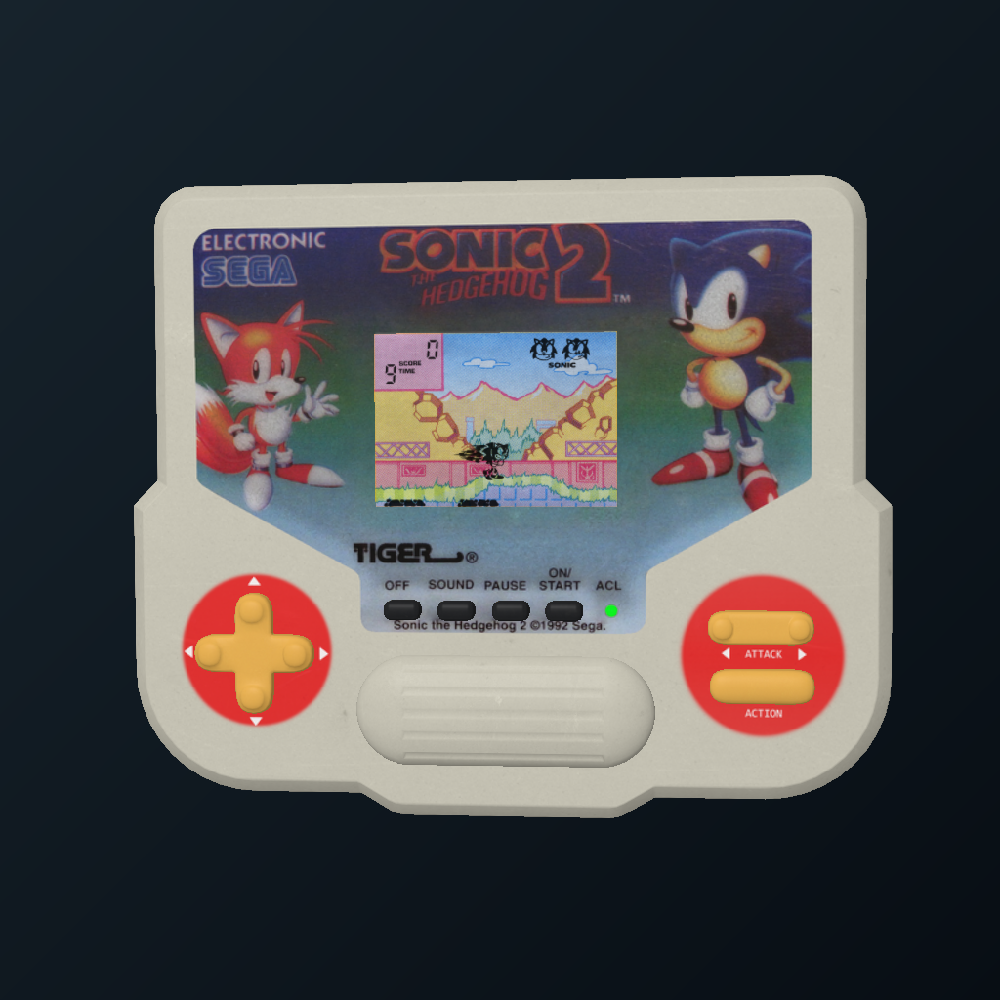

# Sonic Tiger LCD

Play Sonic the Hedgehog from Internet Archive inside a 3D Tiger handheld on Steam Frame. Pick it up, play, and keep it on your MagicShelf. Free. Internet required. No ROM import.

## Playing

Wait for the game screen, then press **X** or point at the model's **ON/START** button and pull the trigger.

- Directions move and jump; **A** activates Spin, **B** pauses, **X** starts, **Y** opens settings.
- Use your free hand to point at the model buttons. Hold the trigger to hold a key; release to let go.
- Both **ATTACK** halves activate Spin. **ACTION** jumps. **ACL** resets the game.
- Hold grip to pick up; release to place. The holding stick adjusts distance. Home or a deliberate shake returns it to the shelf.
- **Y** opens sound, volume and Reload Online Player. Loading failures offer Retry.

The casing is Mattyew's Sonic 2 model; the hosted game is Sonic 1. The original handheld's sound cues are intermittent. Settings persist, but online game state restarts when the creation is turned Off or the player is reloaded. Archive.org availability and loading times can vary.

## Credits and source links

This work is based on **[Tiger Handheld Games Console](https://sketchfab.com/3d-models/tiger-handheld-games-console-20d9825be3b64e89b275ee062455691c)** by **[Mattyew](https://sketchfab.com/mattyu)**, licensed under **[CC BY 4.0](https://creativecommons.org/licenses/by/4.0/)**. The original supplied author link, https://sketchfab.com/mrgrandgrind, is retained in [ASSET_CREDITS.md](ASSET_CREDITS.md). Changes: converted/scaled mesh and textures, removed the baked screen, added live screen rendering and interactive button targets.

- [Internet Archive Sonic player](https://archive.org/details/hh_tsonic): hosted emulator, game content and original screen background.
- [Emularity](https://github.com/db48x/emularity): Daniel Brooks and contributors' browser emulator loader.
- [MAME](https://www.mamedev.org/): MAMEDev and contributors' emulation, provided by the hosted player.
- [Qt WebEngine](https://doc.qt.io/qt-6.10/qtwebengine-licensing.html): Qt Project and Chromium contributors; dynamically linked SteamOS browser runtime.
- [Valve OpenVR](https://github.com/ValveSoftware/openvr): VR integration, BSD-3-Clause.
- [MagicShelf](https://github.com/josethevrtech/magicshelf): SDK and framework, MIT. Integration by josethevrtech.
- [bzhxx / hap](https://github.com/bzhxx/LCD-Game-Emulator): retained native-core development reference; not the online backend.

Sega/Tiger game material, characters and trademarks retain their respective rights. No ROM, melody ROM or SVG game artwork is packaged. The model license does not relicense the game. This is a fan-made integration, not an official Sega, Tiger Electronics or Internet Archive product. See [ASSET_CREDITS.md](ASSET_CREDITS.md), [THIRD_PARTY_NOTICES.md](THIRD_PARTY_NOTICES.md), [LICENSE](LICENSE), [SDK-LICENSE.txt](SDK-LICENSE.txt) and [OPENVR-LICENSE.txt](OPENVR-LICENSE.txt).

## Development and release

Use `python3 tools/fetch_sdk.py`, then `./build.sh`. Requires C++17/GCC, Qt6 Widgets/WebEngine Widgets, Cairo, EGL/GLES3, json-c, PulseAudio simple and OpenVR. The release target is Steam Frame ARM64 on SteamOS, tested with Qt 6.10.2. Override `OPENVR_LIB_DIR` for local WSL builds.

`./build.sh --tests-only` checks measured model hit targets and the retained native reference. Private reference-ROM tests run only when `local/content` exists. `SONIC_NO_AUDIO=1 ./build.sh --online-tests` checks the actual online player, short taps, independent holds, settings and offline handling without making headset sound.

The sandboxed browser runs separately from VR tracking, with memory-only HTTP cache and no persistent cookies. Game content is loaded by Archive's own embed. A private shared buffer exchanges completed frames and input; the tracking thread never waits on browser work.

Screenshots are real native renders using a completed frame from the actual online player and the actual settings UI. [Capture provenance and image credits](media/README.md). [Validation details](FIDELITY.md).

**Publication preparation only:** see [release review](release/RELEASE_REVIEW.md). No public repository, release or MagicShelf catalog change has been published by this preparation.
