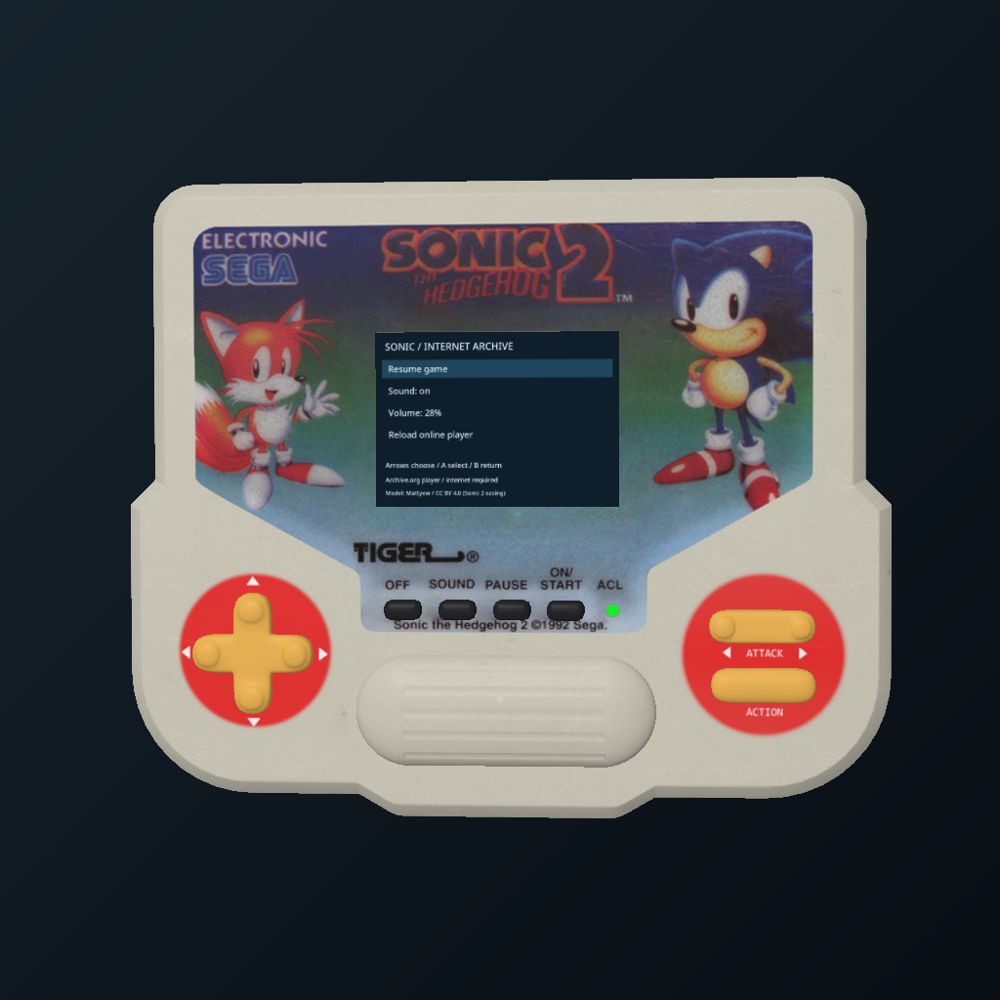
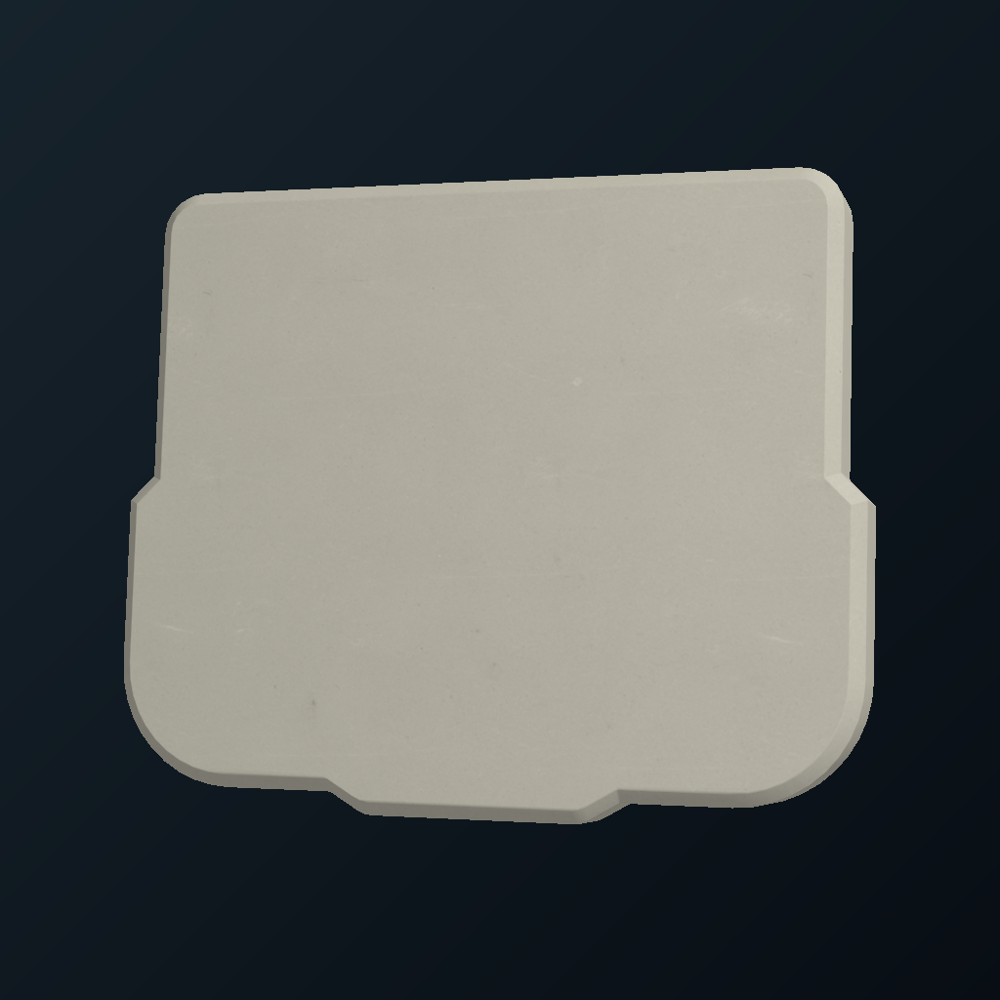

# Publication review: Sonic Tiger LCD v0.2.3

Prepared locally; not published. The running headset installation remains v0.2.2.

## Listing and screenshots

[Full MagicShelf listing](LISTING.md) includes the description, controls, limitations, eight credits and source/license links. The screenshots are 1024 x 1024 PNGs with embedded attribution. [Capture provenance](../media/README.md) describes exactly how they were made.

## Prepared artifacts

The curated upload folder is `dist/publish-v0.2.3/`: one ARM64 creation package, its catalog and checksum, three screenshots, credits/license notices, release notes, a matching source archive and release-wide checksums. Upload that folder's curated contents, not every older file in dist/.

[CHECKS.json](CHECKS.json) records the final package hash, image hashes, contract checks and privacy audit. No game ROM, melody ROM, SVG artwork, original download archives, credentials or private saves are included. The converted model and screenshot license notices are included.

## Validation and limits

The native/core reference, all 12 measured model targets, online player, zero-duration model tap delivery, combined holds/releases, settings, offline handling and actual audio checks passed on Frame. Later network tests and screenshot capture were silent. The user confirmed the 3D ON/START control works. The current app has recorded other model clicks and browser key acknowledgements, but every model key and shake/snap recovery has not been physically signed off. Long-session validation remains limited.

The online player needs Archive.org at launch and follows its availability. Online game state restarts across Off/reload; settings persist. The casing is Sonic 2 while gameplay is Sonic 1. The release uses the SteamOS system Qt runtime, tested with Qt 6.10.2 on this Frame; it does not bundle a browser distribution.

## Publication boundary

No new GitHub repository, tag, release, catalog entry or collection subscription was created during preparation. The proposed catalog/collections patch is stored in [magicshelf-catalog.patch](magicshelf-catalog.patch), based on the exact public revision in framework-base/provenance.json. Apply it only after the real release URLs are live and checked.

[Publication steps](PUBLISH.md) cover source creation, release uploads, URL checks and the final MagicShelf catalog change. The repository, source/issues links and screenshot URLs in this candidate become live when published; they are intentionally not presented as already available.
